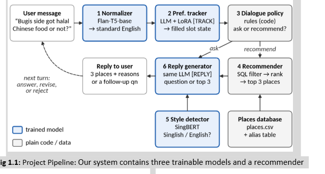

# Makan Where? : a Singlish Conversational Restaurant Recommender

**Research question:** How effectively can Singlish-aware conversational preference tracking support relevant restaurant recommendations in multi-turn dialogue?

## Overview

Our project is a Singlish-aware conversational restaurant recommendation system that combines Singlish normalization, multi-turn preference tracking, adaptive slot-based retrieval, and style-conditioned response generation. The system extracts structured preferences from the dialogue, uses them to query a restaurant database and recommend relevant options.

## Why is this challenging?

Singlish is primarily a spoken creole with no single standardized written form. As a result, many Singlish words (especially loanwords derived from Malay, Hokkien, etc.) end up being spelt inconsistently over text, adding another layer of complexity. Users may also express preferences indirectly, or across multiple turns.

## Preferences tracked

Each slot is one of three states: `UNKNOWN` (not mentioned), `ANY` (user indicated no preference) or a value. Slots are tiered so the bot never asks about all six before recommending.

| Slot | Example values | Singlish example | Tier |
| --- | --- | --- | --- |
| cuisine | Chinese, Korean, Indian | "I want eat korean" | Required |
| area | Bugis, Chinatown, near SMU | "near Bugis side got?" | Required |
| budget | below $5, $10–20 | "cheap cheap pls", "below five dollar" | Hard filter if stated; otherwise not asked |
| dietary | halal, vegetarian, no beef | "must be halal hor" | Soft; default "any" |
| setting | hawker, aircon, café | "got aircon one or not?" | Soft; default "any" |
| time | now, late night, lunch | "dur supper still open?" | Soft; default "any" |

## Method

*Fig 1.1: Project pipeline. Our system contains three trainable models and a recommender.*

The pipeline has these components:

1. **Normalizer:** Rewrites Singlish into standard English ("Bugis side got halal chicken rice?" → "Is there halal chicken rice near Bugis?"). Original and normalized text are both passed on, so nuance lost in translation remains available.
2. **Preference tracker:** Reads the whole conversation and outputs the full slot state every turn, so revisions ("actually Chinese not Korean") simply overwrite a slot. Rejections are treated as critiques: "too far lah" shrinks the search radius, "ex leh" lowers the budget, and the rejected place is excluded.
3. **Dialogue policy:** Determines whether the system has enough information to recommend. If too many candidates remain, it asks a targeted follow-up about the missing preference that would most reduce the candidate set. Questions use relevant options from the restaurant database, e.g. "Bugis side got Malay, Chinese, Japanese - you want which?" The system recommends after sufficient information is obtained or after a limited number of follow-ups.
4. **Recommender:** A hybrid knowledge-based (following rules like "must be halal") and content-based recommender.
   - **(a) Candidates:** a parameterized SQL query built only from filled slots (`UNKNOWN` and `DONTCARE` add no condition), after mapping dish and area names to canonical forms via the alias table; hard constraints (dietary, area radius, opening hours, excluded places) filter.
   - **(b) Ranking:** `score = w₁·content similarity + w₂·soft-slot match + w₃·quality + w₄·distance`.
     - *Content similarity* = embedding similarity between the normalized user request and each restaurant's available text profile, such as its name, category, and description/snippet.
     - *Soft-slot match* = partial credit for flexible preferences like budget and setting. For example, if a user just says "i want something cheap", restaurants that have lower prices receive a higher score while slightly higher ones still get a partial score for recommendation.
     - *Quality* = Bayesian-averaged rating, so a few 5-star reviews can't beat thousands of 4.5s.
     - *Distance* = based on geographical-distance decay.
   - **(c) Feedback:** When the user rejects something, the next search changes.
   - **(d) Fallback:** If no restaurants satisfy the hard constraints, the system relaxes the lowest-priority soft preference while preserving hard constraints and informs the user.
5. **Style detector:** Classifies whether the user is writing Singlish or standard English.
6. **Reply generator:** The same LLM, conditioned on the policy's action (ask about given slots, or present results) and the style tag. It names only places returned by the recommender and explains each with matched features ("halal, ~$5, 300 m away").

## Models and data pipeline

We train three models, and only one is an LLM. The recommender is plain code and needs no training.

| Component | Model | Size | Training |
| --- | --- | --- | --- |
| Preference tracker + reply generator | One LLM: Qwen2.5-1.5B-Instruct (or SEA-LION) + one LoRA (Low-Rank Adaptation) adapter, with a task label `[TRACK]` or `[REPLY]` on each example | 1.5B | QLoRA with MultiWOZ dataset |
| Singlish normalizer | Flan-T5-base | 250M | Full fine-tune on the Singlish–English pairs |
| Style detector | SingBERT classifier | 110M | Full fine-tune on labelled Singlish and English sentences |
| Recommender | Python code | none | None; searches `places.csv` directly |

## Data

All raw sources are merged into four master files, which scripts turn into one training file per model.

| Master file | Built from | Consolidation |
| --- | --- | --- |
| `places.csv` (+ alias table) — database | NEA hawker centres and licensed eating establishments (data.gov.sg); OpenStreetMap (cuisine, halal, opening hours); MakanMetrics; Google Maps scrape | Deduplicate by postal code + similar name. Alias table for different Singlish synonym slangs |
| `dialogues.jsonl` — preference tracker | MultiWOZ 2.2 (public English restaurant-search dialogues with labelled preferences) | MultiWOZ slots mapped to ours (food → cuisine, pricerange → budget, "dontcare" kept) |
| `pairs.jsonl` — normalizer | SEAT (1,500 human-translated NUS SMS pairs); Singlish-to-english-synthetic; Singlish-english-aligned-translation-seat | Remove duplicates and fix loose translations |
| `style.jsonl` — style detector | Singlish: CoSEM (Corpus of Singapore English Messages), NUS SMS Corpus. English: English sides of pairs, MultiWOZ user turns | Balance the two classes and drop very short messages |

## Evaluation

- **Normalizer:** BLEU and chrF on the SEAT test set.
- **Style detector:** F1 score on held-out sentences.
- **Preference tracking:** Compare predicted slots with labelled ground truth (F1 score).
- **Recommender:** Precision@K, nDCG@K and hit rate@K against team-judged relevant places for 50–100 test dialogues; hard-constraint violation rate (target 0%).
- **End-to-end:** Task success and turns needed to reach an accepted recommendation; compare performance on Singlish vs standard English inputs.

## Plan

1. **Collect data:** consolidate and build the four master files and alias table.
2. **Build policy and recommender:** deterministic code.
3. **Train models:** fine-tune Singlish normalization, Qwen2.5-1.5B preference tracking and response generation, SingBERT for Singlish/English style classification.
4. **Pipeline integration** end-to-end.
5. **Evaluate and iterate** using metrics and ablations.

## Duty of work

| Member | Responsibilities |
| --- | --- |
| Denise Lie | Train Qwen generator `[REPLY]`, integrate end-to-end pipeline, and lead task success evaluations |
| Nichole | Build dialogue dataset, fine-tune Qwen tracker `[TRACK]`, and write dialogue policy logic |
| Varidhi Goyal | Build datasets and fine-tune Flan-T5 normalizer and SingBERT style classifier |
| Yuhanna | Build places database, alias table, SQL filters, and the hybrid ranking recommender |
